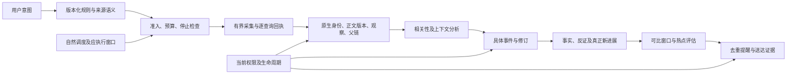
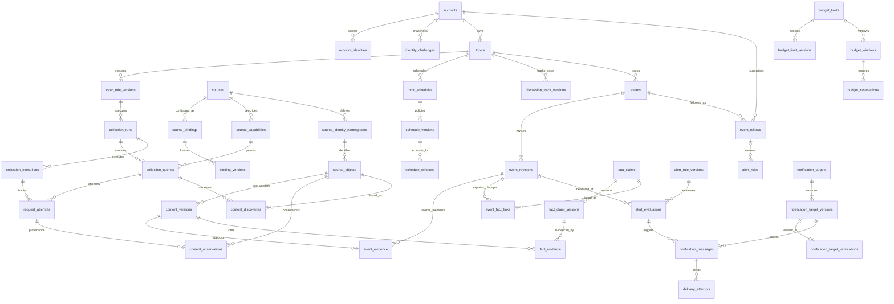

# 00 产品目标与边界

本文件定义目标架构、共用数据约束和接口原则；业务范围见[00需求](../requirement/00-产品目标与边界.md)，实际运行架构见根目录PROJECT。目标方案需独立评审，不为兼容现有代码保留错误方案，也不据此授权修改业务库。

## 目标系统分解与选型原则

| 业务职责 | 输入 | 输出 | 必须成立的不变量 |
|---|---|---|---|
| 意图与规则 | 用户配置、来源能力 | 版本化规则与可执行范围 | 预览/保存不采集；不静默丢条件 |
| 准入与采集 | 已授权规则/窗口/预算 | 材料、发现解释与覆盖回执 | 每个请求可停止、有预算；失败不算零 |
| 内容与证据 | 原生对象和实际响应 | 稳定身份、正文版本、观察与父链 | 跨源转载不误去重；时间语义分开 |
| 分析与事件 | 实际可读版本及上下文 | 相关性、事件、事实与修订 | 不确定可暂缓；引文存在；纠错不改原生身份 |
| 持续与提醒 | 应执行窗口、可比测量与规则 | 调度解释、评估、去重提醒与送达证据 | 静默与停止明确；未知外部效果不默认重发 |
| 权限与生命周期 | 当前身份/许可/删除政策 | 允许内容范围与清理回执 | 历史、缓存、派生物不能绕过撤回 |

这是逻辑职责划分，不要求各建一个服务或进程。先比较单机事务+持久执行与需要消息中间件的方案；以故障恢复、观测、吞吐基线和维护成本决定。关系模型因跨实体完整性需要而提出，具体产品/队列/缓存/算法仍需设计评审。单机模型也必须持久保存应执行窗口和未知外部效果，不能靠内存定时器保证恢复。

### 核心链路

### 关键状态机

- 主题：draft → active ↔ paused → archived。归档/暂停使旧状态授权失效；恢复不能复活旧运行。
- 采集：accepted → running → succeeded / partial / failed / cancelled / unknown。complete仅描述能够证明终点的查询；不代表来源全量。
- 分析：pending → running → valid / invalid / failed / unknown；限流进入deferred再恢复。结果可为insufficient，不强行二分类。
- 事件：clue / event / insufficient为证据分类，active / merged / archived为生命周期，两者独立。
- 提醒：pending → deferred或sending → accepted / delivered / failed / unknown。只有送达证据才能delivered；unknown先核对。

枚举是目标合同提案，正式实施时逐条确认允许转换、执行者、版本前置、失败补偿和可见回执，不把它们直接映射到当前代码字符串。

## 数据库设计

数据模型围绕“监测意图—采集身份—证据版本—事件/事实—窗口判断—提醒效果”推导。个人数据使用owner归属；公开目录与个人绑定分离。原帖/评论/回复共用原生对象身份，正文版本与观察分开；事件及事实只引用材料版本，避免另造正文真源。

### 主要实体关系

ER图省略部分安全/预算与审计实体，完整归属和字段见下表。ER连线表示业务关系，落实为复合外键或事务内可验证关系，不意味着所有JSON引用已得到数据库强制保护。

### 共用数据约定

- UUID用于业务身份，BIGINT用于递增版本；业务时间以带时区UTC持久化，接口显式时区。窗口左闭右开，未知时间允许空，不能补造。
- 个人表的owner_id指向账户；被引用个人实体提供UNIQUE(owner_id,id)，跨实体引用优先使用包含owner_id的复合外键。只检查单列ID不能防跨账户关联。
- 版本内容不可原地覆盖；当前指针变更使用预期版本，并与新修订及审计同事务。自引用/JSON中的归属、环与有效版本无法仅靠普通FK时，必须有服务校验和独立完整性核对。
- JSON仅用于来源差异、冻结输入或有版本的证据快照，不能用一个无模式JSON代替需要独立查询/约束的业务实体。规范化关联与JSON快照如何取舍须记录消费者和一致性理由。
- 凭据不入库明文；令牌仅摘要，外部凭据只保留允许的本机引用。正文、模型输入与回执按敏感性及许可管理，不进入普通日志。
- 计量从明确归属的事实计算；为性能物化时写明输入版本/窗口与重建条件，不能把缓存当事实真源。历史清理后统计无法重建须显示限制。
- 外键ON DELETE不一律CASCADE：身份/修订/审计关系优先显式清理或RESTRICT；可派生关联可删除。源删除、逻辑不可见和物理清理分阶段完成，并防止中间态泄漏。

### 事务与并发边界

| 业务变化 | 原子提交的内容 | 失败/重复处理 |
|---|---|---|
| 保存规则 | 新规则版本、主题当前指针、审计 | 比较预期版本；冲突保留草稿；相同operation重放结果 |
| 受理运行 | 冻结规则/来源/状态、查询计划、应执行窗口关联、异步触发记录 | 幂等键唯一；全部跳过仍返回真实查询回执 |
| 请求与入库 | 请求尝试、预算预留/结算、对象/版本/观察及检查点 | 允许分阶段但必须明确未知；已持久响应重放不改原轮次归属 |
| 事件修订 | 新修订、成员、事实关系、当前指针及纠错操作 | 同owner、预期revision；冲突不覆盖；合并不改原帖身份 |
| 提醒生成 | 冻结评估、去重业务消息及待发送事件 | 唯一语义去重键；外部发送在事务外，未知先核对 |
| 删除撤权 | 立即不可读政策、清理请求及目标 | 清理可重试；外部文件失败不恢复读取许可 |

外部请求不能与数据库伪装为单个原子事务。外部已发生、数据库未确认的窗口必须能表示unknown；重试依据副作用是否可证明，而不是所有失败一律重发。

### 数据设计归属索引

| 对应需求 | 目标实体/存储 | 设计层级 |
|---|---|---|
| [01 关键词配置](01-关键词配置.md#数据库设计) | `topics`、`topic_rule_versions`、`topic_rule_sources` | 核心字段/键/索引/生命周期 |
| [02 关键词采集](02-关键词采集.md#数据库设计) | `collection_runs`、`collection_queries`、`request_attempts`、`collection_executions`、`discussion_track_versions` | 核心字段/键/索引/生命周期 |
| [03 增量去重与覆盖](03-增量去重与覆盖.md#数据库设计) | `source_objects`、`content_versions`、`content_observations`、`content_discoveries`、`content_relations`、`topic_matches` | 核心字段/键/索引/生命周期 |
| [04 热点事件识别](04-热点事件识别.md#数据库设计) | `events`、`event_revisions`、`event_evidence` | 核心字段/键/索引/生命周期 |
| [05 事件证据与新事实](05-事件证据与新事实.md#数据库设计) | `fact_claims`、`fact_evidence`、`event_fact_links`、`event_corrections`、`fact_claim_versions` | 核心字段/键/索引/生命周期 |
| [06 持续监测与恢复](06-持续监测与恢复.md#数据库设计) | `topic_schedules`、`schedule_windows`、`schedule_versions` | 核心字段/键/索引/生命周期 |
| [07 趋势与告警](07-趋势与告警.md#数据库设计) | `notification_targets`、`alert_rules`、`alert_rule_versions`、`alert_evaluations`、`notification_messages`、`delivery_attempts`、`notification_target_versions`、`notification_target_verifications`、`event_follows` | 核心字段/键/索引/生命周期 |
| [08 平台接入](08-平台接入.md#数据库设计) | `sources`、`source_capabilities`、`source_bindings`、`binding_versions`、`source_identity_namespaces` | 核心字段/键/索引/生命周期 |
| [09 模型分析](09-模型分析.md#数据库设计) | `analysis_runs`、`analysis_results` | 核心字段/键/索引/生命周期 |
| [10 权限与数据生命周期](10-权限与数据生命周期.md#数据库设计) | `access_policies`、`retention_policies`、`deletion_requests`、`deletion_targets` | 核心字段/键/索引/生命周期 |
| [11 质量评测与验收](11-质量评测与验收.md#数据库设计) | `逻辑模型见同编号` | 核心评测逻辑模型；存储载体待验证方案评审 |
| [19 收藏与阅读记录](19-收藏与阅读记录.md#数据库设计) | `本机阅读状态` | 保留能力逻辑模型；物理设计待价值评审 |
| [23 模型综合榜](23-模型综合榜.md#数据库设计) | `逻辑模型见同编号` | 保留能力逻辑模型；物理设计待价值评审 |
| [29 登录与验证注册](29-登录与验证注册.md#数据库设计) | `accounts`、`sessions`、`account_identities`、`identity_challenges` | 核心字段/键/索引/生命周期 |
| [40 平台热榜快照](40-平台热榜快照.md#数据库设计) | `逻辑模型见同编号` | 保留能力逻辑模型；物理设计待价值评审 |
| [41 个人报告列表](41-个人报告列表.md#数据库设计) | `逻辑模型见同编号` | 保留能力逻辑模型；物理设计待价值评审 |
| [42 刊期生产档案](42-刊期生产档案.md#数据库设计) | `逻辑模型见同编号` | 保留能力逻辑模型；物理设计待价值评审 |
| [46 任务记录](46-任务记录.md#数据库设计) | `budget_limits`、`budget_windows`、`budget_reservations`、`outbox_events`、`budget_limit_versions` | 核心字段/键/索引/生命周期 |
| [48 公开许可与发布管理](48-公开许可与发布管理.md#数据库设计) | `逻辑模型见同编号` | 保留能力逻辑模型；物理设计待价值评审 |
| [49 运营工作区](49-运营工作区.md#数据库设计) | `audit_events` | 核心字段/键/索引/生命周期 |
| [51 站点联系配置](51-站点联系配置.md#数据库设计) | `逻辑模型见同编号` | 保留能力逻辑模型；物理设计待价值评审 |
| [52 意见反馈](52-意见反馈.md#数据库设计) | `逻辑模型见同编号` | 保留能力逻辑模型；物理设计待价值评审 |

### 现有实现差距与迁移评审

不把目标表名与现有表名逐字比较后宣布迁移必要。后续按实体职责、业务约束、当前数据与消费者，决定复用、改造、替换或删除；当前表多/少均不单独证明设计优劣。需验证原生身份、版本/观察、评论父链、事件/事实/更正、应执行窗口、首次提醒去重及删除是否真的满足需求。

本轮只产出目标模型。后续如获准结构变化，先完善真实DDL、ORM与结构断言，核对所有消费者、容量和兼容，再按PROJECT的空库/备份恢复流程制定数据映射与回退；不得因本文提案直接修改业务库或删表。模型中未冻结的字段、JSON/FK选择和辅助物理结构是设计评审事项，不能伪称已完成数据库验收。

## 接口与异步合同设计

接口名称为业务操作，不绑定旧路由；正式API仍由获批实现生成OpenAPI，本文不维护第二份OpenAPI。

| 操作 | 必要输入 | 成功结果 | 必须区分的失败/未知 |
|---|---|---|---|
| 保存主题规则 | 本人身份、配置、expected_version、operation_id | 主题身份、新规则版本、可执行范围/限制 | 校验失败、无权限、冲突；保存不执行 |
| 预览规则 | 规则草稿、已存样本范围 | 本地命中解释、来源召回/精筛/未支持说明 | 过期预览、未知语言、未支持；不联网 |
| 运行/调度受理 | 主题、规则/状态版本、窗口、operation_id | 运行ID或全部跳过回执、逐查询判定 | 未准入、预算、静默、到期、重复受理 |
| 读取材料/事件 | 当前身份/许可、稳定ID、可选修订和绑定条件cursor | 当前可读投影、版本、分母、缺口、下一页 | 不存在/撤权、过期cursor、故障；不触发外部动作 |
| 提交事件纠错 | 目标事件、expected_revisions、动作、证据、原因、operation_id | 新修订、身份继承和影响范围 | 版本冲突、非法跨owner引用、证据不足 |
| 启停/恢复 | 当前状态/版本、原因、operation_id | 状态回执、在途影响和新执行授权 | 状态不允许、未知外部效果；不复活旧运行 |
| 配置提醒/目标 | 条件、目标验证、版本、静默、operation_id | 规则版本、未来作用范围 | 目标失效/收费/未支持；不自动重发历史热点 |
| 查询/核对投递 | 消息ID、当前权限 | 评估、发送尝试、provider回执、实际收到证据 | accepted/delivered/unknown分开，核对前不重发 |

错误返回稳定code、可读说明、关联request/operation、可恢复动作；不能靠文本匹配错误分支。分页cursor绑定owner、筛选、排序与必要版本，不接收可跨资源复用的裸游标。读接口明确范围、快照及过期状态；写接口不靠前端去重或隐藏按钮保证一致性。

## 共享视觉规范

桌面视觉以AGENTS指定的Figma稿为设计输入，保留黑白、留白、清晰层级与品牌识别；不能为匹配稿面隐藏必需证据、状态或操作。标题、正文、元信息和数字层级统一，颜色使用语义令牌；负面/错误/未知同时有文字，不仅靠颜色。

1440px与390px、200%缩放、键盘及减少动态效果按NFR-12核对。布局可随任务重评，避免固定尺寸造成信息不可达；窄屏主要动作可用，导航不遮挡内容，打印回到可读文档流。动效可被偏好关闭且不阻断任务。

## 共享组件规范

实现时遵守AGENTS中的Web规范及经过评审的设计系统；设计文档只规定组件需要承担的输入、状态、焦点、阅读和恢复职责，不复制代码目录/包配置为第二份工程规则。富文本、媒体和外部链接统一安全白名单渲染，不能执行来源脚本。

## 共享外壳与布局

公开阅读与个人工作入口清楚可发现，登录状态真实。资源身份、筛选、排序与返回路径可定位；个人入口在未登录时提供验证入口，关闭后继续公开阅读。跨页导航、主要内容地标、正文滚动及浮层焦点应可键盘操作。当前页数、栏宽、首屏数量、路由形式不构成业务范围。

## 版本与完整性决策

核心身份行只保存当前指针及当前状态投影；正文、规则、连接、事件/事实、调度、提醒目标和预算政策都有明确历史依据。各归属设计给出复合FK，当前指针与版本写入同事务。状态授权历史由结构化审计支持离线窗口重建；讨论跟踪有版本和退出条件；能力按具体行引用，预算按稳定身份及时间窗计量，验证绑定目标版本和地址摘要。

当前核心候选实体数量由归属索引自动核对，数量不是设计质量或发布门槛。字段、键、JSON schema与跨实体关系须在正式DDL和独立完整性验证中落实；本轮只评审文档，不能声称数据库约束已经执行。

### 公开关注的归属例外

个人跟踪状态属于订阅者，公开事件属于发布者，不能强行伪装同owner。07 event_follows显式区分owner_id/event_owner_id并绑定公开投影；其评估仅引用许可的已发布修订，发送和计数不得泄露原始私人材料。除这一明确公开订阅关系外，私人引用仍按同owner复合FK拒绝越权。
